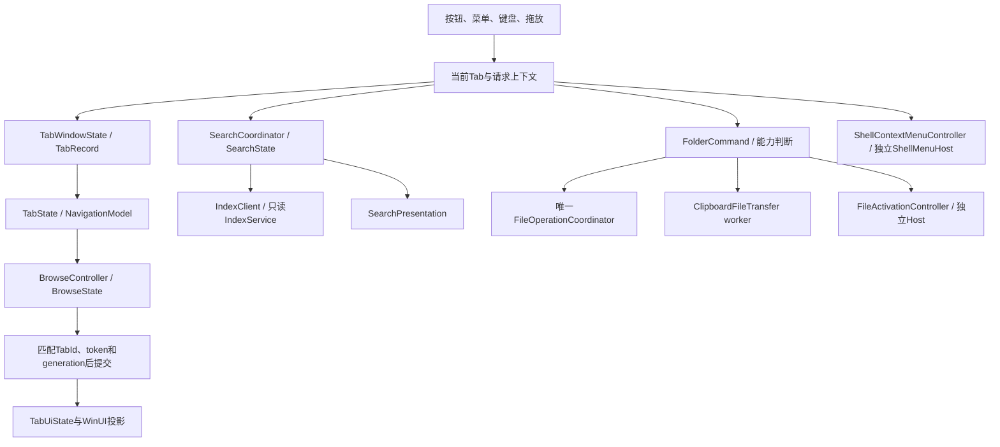

# Explorer UI 事实基线与交互规范

审计日期：2026-11-08；G02实现更新：2026-11-09；G03a实现更新：2026-11-10（最终同一Release限定GUI53项已验）。阶段A源码基线：`7135a14`；只读规范提交：`e497600`。最终WM_CLOSE修正后Debug/Release构建与原生回归各1565 PASS/0 FAIL/4既有权限SKIP，246输入/378资源；同一Release地址20/命令18/查看15，合计53 PASS/0 FAIL/0 SKIP。独立关闭A/B/C/D四项均exit0，C真后台、D无WM_CLOSE fallback。旧Debug52项仅preflight，不混入最终Release；完整G03/P0仍`PARTIAL`，默认版发布状态按交接记录，不由验证结果推断。

本规范依据用户提供的《Blink × Windows 11 文件资源管理器：完整 UI、菜单与交互兼容任务书》完整 316 行，以及实际窗口、导航、列表、搜索、菜单、状态和对话框源码编制。任务书要求的目标环境是 Windows 11 24H2 x64；这不等于本文件已在该版本完成整套界面验收。

本文更新代理只核对源码、主模型提供的验证记录和既有参考资料，没有另行构建或运行GUI。G01受控GUI为15 PASS/0 FAIL/0 SKIP，另有独立的Explorer查看/显示参考观察；二者环境采样与边界保留于第7节。G02原生结果与最终18项GUI结果单独记录，不能外推为整套界面验收。

## 1. 基线、证据与状态口径

最新事实按 `PROGRESS.md` 和源码判断，不沿用历史计划中的旧 TODO。当前基线已有目录 Copy/Move Merge、普通目录与搜索的共同菜单外观、路径复制和独立系统扩展承载；这些不再列为缺失。

| 证据 | 可支持的结论 | 不能外推的结论 |
| --- | --- | --- |
| G03a最终两配置`tests-debug.log/tests-release.log`及[地址20项](../.build/explorer-address-bar/integration/ui-address-bar-report.json)、[命令18项](../.build/explorer-address-bar/integration/ui-command-bar-compat-report.json)、[查看15项](../.build/explorer-address-bar/integration/ui-view-compat-report.json)；246输入/378资源 | 两配置各1565/0/4，新增23项地址模型；同一Release `CF1D8A2B...` 三套GUI合计53/0/0，含编辑中直接关闭及命令/查看兼容重跑 | 旧Debug52项仅preflight，不代替当前53项；下级目录菜单、自动完成、完整G03/P0及完整人工/环境矩阵不外推 |
| [最终关闭专项](../.build/explorer-address-bar/integration/window-close-probe/fixed/probe-report.json) | 同一Release A/B/C/D四项均PASS、exit0；C通过自有WinForms伴随窗口确认Ctrl+L前后都为真后台，D实际Ctrl+W关闭唯一Tab且无WM_CLOSE fallback | 独立四项不加入53的计数；只验证这些实际焦点/关闭路径，不泛化真实IME、全部失焦或环境矩阵 |
| [G02命令栏交接](EXPLORER_COMMAND_BAR_HANDOFF.md)；`.build/explorer-command-bar/integration/tests-debug.log`、`tests-release.log` | 当前240冻结输入哈希匹配/375资源；Hidden/Search修正后Debug、Release完整构建均成功，普通回归各1542 PASS/0 FAIL/4符号链接权限1314 SKIP；26项新增检查（23项命令栏策略/选择模型、3项搜索生命周期） | 原生策略测试不是按钮操作、菜单键盘、动态溢出或完整GUI验收；修正后Release同一完整脚本18 PASS/0 FAIL/0 SKIP，#08 Hidden→#14真实索引/PasteParent已串联通过；不代表未点击排序叶、整P0或完整环境矩阵 |
| [首个P0交接](EXPLORER_VIEW_MENU_HANDOFF.md)；`.build/explorer-ui-p0-view-menu/integration/native-validation.json`及`ui-view-menu-report.json` | 首个P0最终235输入/369资源；Debug、Release各1516 PASS/0 FAIL/4权限SKIP；受控GUI 15 PASS/0 FAIL/0 SKIP | 限View/Show及其集成；该G01旧候选当时已发布并打开，证据见该历史轮次published-runtime/default-runtime-opened记录，不作为本轮发布或当前窗口事实 |
| 阶段A历史：`PROGRESS.md`的目录移动合并段；[Slice21交接](PHASE1D_SLICE21_HANDOFF.md)；`.build/phase1d-slice21/integration/native-validation.json` | 235 冻结输入、368 中英/fallback 资源；Debug/Release 各 1516 PASS、0 FAIL、4 权限 SKIP；构建并发 1 | 不是整个 Explorer UI、全部设备或全部主题认证 |
| `.build/phase1d-slice21/integration/ui-move-merge-report.json` | 自有生产窗口 8 PASS；真实根 Merge、子项 Replace/Skip、字节与来源保留、完整合并根/空目录移除、正常退出和清理 | 本轮没有 behind-source-child Tab 跟随的 GUI 验收 |
| [普通目录菜单交接](FOLDER_MENU_SYNC_HANDOFF.md)；`.build/folder-menu-sync/integration/ui-folder-menu-report.json` | 历史普通目录 21 项；三视图与排序实际顺序、路径、粘贴、属性、过期选择；另有搜索 18 项记录 | 不是所有 12 类右键上下文齐全，也不是像素对照 |
| [搜索范围交接](SEARCH_SCOPE_HANDOFF.md)；`.build/search-scope/integration/ui-scope-report.json` | 历史范围 UIA 19 PASS，按标签草稿、实际范围与提交行为已有证据 | 不是所有搜索体验、首屏性能或全键盘矩阵通过 |
| [搜索性能交接](SEARCH_PERFORMANCE_HANDOFF.md) | IPC 性能与真实 C/D 索引、USN、Open/Locate 已验证；同卷更新/保存 Busy 和实际 UI 首屏仍待优化 | 不宣称与 Everything 等速 |

状态使用任务书规定的六种值：`IMPLEMENTED_VERIFIED`、`IMPLEMENTED_NEEDS_MANUAL`、`PARTIAL`、`DEFERRED`、`UNSUPPORTED_BY_DESIGN`、`OS_DEPENDENT`。状态必须限定到具体能力；同一控件可以功能已验、缩放与读屏未验。后文 `NOT RUN` 是验证状态，不是新增的产品能力状态。

## 2. 实际窗口控件树

以下为含G03a的当前实现树，按源码核对；新增地址host和原生overflow已有本机最终Release UIA证据，限定见第8.2节。导航下方有独立命令行，行容器横跨左右窗格；`CommandBar`本体使用`HorizontalAlignment.Left`按内容期望宽度左对齐，不能据此宣称其实际bounds铺满窗口。旧视图Combo、独立隐藏CheckBox、G01的DropDownButton和排序Combo/方向按钮均已由当前入口替换。尺寸单位为源码WinUI逻辑像素，不等同UIA采样bounds；`#`后为源码设置的AutomationId。

```text
Window / AppWindow / 系统 caption buttons
  ExtendsContentIntoTitleBar=true；SystemBackdrop=MicaBackdrop
  window_frame_: Grid [Auto, *]
  ├─ TitleBar #BlinkTitleBar [高48；系统拖动区和caption保留区]
  │  └─ TabView #WindowTabs [高48；Add/Close；文件拖放到Tab]
  └─ root_: Grid [Padding=12,10,12,8；行48,Auto,*,30,Auto]
     ├─ 行0 navigation_bar: Grid [40,40,40,40,*,220]
     │  ├─ Back / Forward / Up / Refresh Button
     │  ├─ AddressBarPresentation → ContentControl #AddressBar [高32；Margin=6,0,8,0]
     │  │  ├─ BreadcrumbBar #AddressBreadcrumbs [默认显示；原生祖先点击/overflow]
     │  │  ├─ TextBox #AddressEditor [编辑时显示；path_box_只保留此控件别名]
     │  │  └─ Button #AddressHistoryButton → MenuFlyout #AddressHistoryMenu
     │  │     └─ #AddressHistory0... [仅当前Tab已commit的current/back/forward]
     │  └─ search_box_: TextBox #SearchQuery [Enter搜索；Esc离开搜索]
     ├─ 行1：独立命令行（横跨左右窗格）
     │  └─ CommandBar #ExplorerCommandBar [Left；DynamicOverflow]
     │     ├─ PrimaryCommands：8个标准AppBarButton
     │     │  ├─ 新建 #CommandNew → MenuFlyout #TopNewMenu
     │     │  │  └─ 新建文件夹 #TopNewFolder（仅真实已实现类型）
     │     │  ├─ 剪切 #CommandCut / 复制 #CommandCopy / 粘贴 #CommandPaste
     │     │  ├─ 重命名 #CommandRename / 删除 #CommandDelete
     │     │  ├─ 排序 #CommandSort → MenuFlyout #TopSortMenu
     │     │  │  └─ #TopSortName/Modified/Type/Size；分隔；Ascending/Descending
     │     │  └─ 查看 #FolderViewMode → MenuFlyout #TopViewMenu
     │     │     ├─ Toggle #TopViewGrid / #TopViewList / #TopViewDetails
     │     │     └─ 分隔 + SubItem #TopViewShow → Toggle #TopViewShowHidden
     │     └─ 系统原生MoreButton“…” → Popup #OverflowPopup [UIA Window]
     │        ├─ SecondaryCommands：#CommandSelectAll/ClearSelection/InvertSelection
     │        ├─ #CommandProperties / #CommandRefresh
     │        ├─ #CommandCopyFullPath / #CommandCopyParentPath
     │        └─ 窄宽时动态移入的PrimaryCommands（不另造第二个More按钮）
     ├─ 行2 body: Grid [220,*]
     │  ├─ ScrollViewer #NavigationPane [唯一纵向滚动owner]
     │  │  └─ 位置标题/快捷位置ListView；驱动器标题/异步lazy TreeView
     │  └─ 右侧同一单元格按browse/search切换
     │     ├─ content_grid_: Grid [0,Auto,*；旧命令行高0]
     │     │  ├─ details_header_: Grid [高32；名称*/类型140/大小110/修改180]
     │     │  │  └─ 4个Button列头，点击排序
     │     │  └─ ListView或GridView #FolderEntries [Extended选择]
     │     └─ search_surface_: SearchPresentation Grid [Auto,Auto,Auto,Auto,*]
     │        ├─ #SearchEffectiveScope；#SearchSubmit/Retry/Open/Locate/Leave
     │        ├─ Expander #SearchAdvanced [默认收起]
     │        │  └─ #SearchScope/Mode/SelectedVolumes/SelectedFolder/UseCurrentFolder
     │        │     #SearchIncludeSubfolders / #SearchShowHiddenItems
     │        ├─ summary、action/limit messages；逐卷状态Expander
     │        └─ ListView #SearchResults [Single选择；名称/全路径/卷]
     ├─ 行3 status_bar: Grid [*,140,180]
     │  ├─ status_ / selection_status_: TextBlock
     │  └─ Button #IndexServiceStatus → Flyout/ScrollViewer [MaxHeight=420]
     │     [概要、#IndexVolumeRoot、逐卷状态、#IndexServiceEnable/#IndexVolumeBuild/#IndexServiceRetry]
     └─ 行4 operation_panel_: Grid [*,Auto,Auto,Auto；按状态显示]
        [#FileOperationStatus、#FileOperationCancel、#NewFolderRetry、#DeleteSkip]
```

临时可见面：普通目录 `MenuFlyout` presenter `#FolderContextMenu`，搜索 `#SearchContextMenu`，各自的子菜单；WinUI `ContentDialog` 名称编辑、冲突、永久删除确认、只读属性；搜索/普通目录“压缩与更多系统选项…”和搜索系统属性由进程外 `Blink.ShellMenuHost` 展示。菜单完整树及 12 类场景见[菜单矩阵](EXPLORER_MENU_MATRIX.md)。

入口以符号定位：`main.cpp::BuildWindowFrame/BuildUi/BuildFolderViewCommands`，`PopulateCommandBarMenu/PopulateFolderViewMenu/SyncCommandBarState/SyncFolderViewCommands`；展示控件归`CommandBarPresentation.h/.cpp`。G02启动结构probe实际识别到UIA类`ApplicationBar`、8个`AppBarButton`和系统MoreButton。独立Release原生overflow探针成功，实际入口为`AutomationId=OverflowPopup`、`ClassName=Popup`、`ControlType.Window`；ControlView链为`CommandSelectAll → OverflowPopup → ExplorerCommandBar`，RawView中还包含无ID的ScrollViewer。源码Style给Presenter设置的`TopMoreMenu`未暴露为真实UIA入口，自动化不能依赖它；原始记录归`.build/explorer-command-bar/integration/ui-overflow-probe.json`。这些结构事实不代替动态溢出/键盘/动作的完整验收。G01历史UIA类`Microsoft.UI.Xaml.Controls.DropDownButton`仅适用于旧候选，当前`FolderViewMode`为标准AppBarButton。

## 3. 权威状态、命令和异步发布



| 状态/对象 | 真相来源 | 窗口绑定和已有约束 |
| --- | --- | --- |
| Tab顺序、活动Tab、生命周期 | `TabWindowState.h:35 TabRecord`、`TabWindowState.cpp:109 CreateTab/:121 CloseTab/:164 ActivateTab` | `TabViewItem.Tag=TabId`；切Tab发布当前模型；关闭清理该Tab的browse/search/watcher，不从控件标题识别Tab |
| 当前位置与历史 | `Location.h:10`、`NavigationModel.h`、`NavigationModel.cpp:195 Snapshot` | 只有 ThisPC/Folder 两类 Location；ThisPC不编码成磁盘路径；地址文本不成为已提交位置的第二套真相 |
| 地址编辑与历史展示 | `AddressBarState/BuildAddressBreadcrumbs/BuildAddressHistory`；main的`BuildAddressBar/SyncAddressBar/BeginAddressEdit/CancelAddressEdit` | helper只展示和回调；同Tab自动刷新保留当前编辑草稿，切Tab取消未提交草稿，不跨Tab持久化。历史只取已提交current、最近back/forward并去重；pending/失败/未提交文本不入历史；旧菜单和breadcrumb按owner/revision失效，动作持有Location值 |
| 地址编辑中关闭 | main的`NavigationWheelSubclass/PrepareWindowClose/CloseTab/OnWindowClosed`；`AddressBarPresentation::PrepareForClose/Close` | 既有顶层WM_CLOSE转交WinUI前先将焦点交可见普通/搜索列表，用helper缓存committed取消编辑并隐藏editor，不重建breadcrumb；唯一程序`window_.Close()`前同样准备。Closed只退役回调和shutdown，不访问已清理Tab的ActiveState |
| 在途浏览与已提交页面 | `BrowseState.h:14`；`TabState.h:19`；`TabState.cpp:58 CommitBrowse` | BrowseState为Idle/Loading/Completed/Failed；FolderState是Idle/Ready/Empty，不能混写成同一枚举。新请求失败不改原committed path/history；状态文案说明失败 |
| 页面结果与选择 | `TabState`、`RowIdentity`；`main.cpp:640 TabUiState` | `FileIdentity`标对象，RowIdentity区分硬链接名称；虚拟容器/行号只作展示索引；列表选择回写模型 |
| 视图与排序 | `TabState.view_mode_/sort_`；`main.cpp:3560 ApplyFolderViewMode/:3589 SetFolderViewMode/:3650附近 SetFolderSort` | Details/List/Grid共用同一行对象；改视图不导航、不重读目录；按Tab保存。重新创建控件后的焦点恢复带TabId和view generation |
| 隐藏项目 | `ItemVisibilityPolicy`、`TabWindowState::SetVisibilityPolicy` | 当前是窗口级统一策略，传播各Tab和树；默认隐藏Hidden，System始终不显示；搜索隐藏开关复用该策略。不是跨重启持久化设置 |
| 搜索 | `TabRecord`、`SearchState.h:8`、`SearchPresentation.cpp:445 Update` | 每Tab独立query草稿、范围、模式、selection与动作代次；FollowLocation从committed Location解析；输入不逐字符RPC，Enter/搜索提交；retry复用已提交query |
| 搜索动作/菜单 | `SearchContextSelection{tab_id,query_generation,result}` | 传真实结果副本并重新校验目标；空白右键不复用旧selection；隐藏、切Tab、结果更新使旧菜单失效 |
| 普通目录菜单 | `main.cpp:2962 FolderMenuContext/:2996 IsFolderMenuContextCurrent` | 绑定Tab、呈现、view、operation、selection generation及Location；多选不是只取右击的一行 |
| 文件操作与剪贴板 | `FileOperationCoordinator`、`FileOperationOrigin`、`ClipboardCopyCache` | Copy/Move/Delete/新建/重命名走既有所有权；CF_HDROP和MOVE序列复用原身份；已提交前缀不因续行或再次粘贴重放 |
| 系统菜单和属性 | `ShellContextMenuController`、`Blink.ShellMenuHost/src/main.cpp:257/518/525/572` | `IContextMenu/2/3`查询、消息转发和InvokeCommand；Shell DLL不在Blink.exe加载。完整现代IExplorerCommand覆盖未实现，不以经典菜单冒称 |
| 顶部命令栏 | `ExplorerCommandBarContext/EvaluateExplorerCommandBarAction`；`main.cpp::CommandBarState/CaptureCommandBarContext` | 只从当前Tab/Search与CF_HDROP推导能力；Folder复用FolderCommandPolicy，ThisPC仅真实View/Refresh/More，Search仅当前结果动作且Paste明确为所在目录；不借用背后浏览页 |
| 顶部菜单与overflow | `IsCommandBarContextCurrent/SyncCommandBarState/ExecuteCommandBarAction` | 打开捕获Tab/Location/selection/view/operation/search代次，动作重验；切页/代次变更关闭旧菜单，overflow Closed按dispatcher代次延后清理；剪贴板更新同步启用态。展示helper不执行I/O，也不持有第二套状态 |
| Provider | 现有Provider IPC/Host原型；`PRODUCT_SCOPE.md:18` | 当前UI没有SFTP/WebDAV连接视图；未来远端遵守协议语义，不伪装成本地盘路径 |

保留：普通用户窗口、本地文件系统权威模型、只读索引协议和现有进程隔离。不为本次外观调整重写main、导航/索引模型或文件操作管线。

## 4. 区域能力与实际差距

| 区域 | 阶段A事实及G01/G02/G03a更新 | 与目标任务书的差距 |
| --- | --- | --- |
| 标题栏 | WinUI TitleBar、Tab同排、系统caption和Mica已接入；空白拖动有历史证据；`IMPLEMENTED_NEEDS_MANUAL`用于完整窗口矩阵 | Snap、多显示器移入移出、双击/resize、激活态、高对比度、全部DPI未完成本次统一验证 |
| 标签 | 新建、切换、关闭、当前标题与后台取消有模型/回归；`PARTIAL` | 未见模型级重排API或相应同步、标签右键命令、拖出新窗口；Tab默认行为不能直接当完整功能交付。未实现持久滚动位置/完整会话恢复 |
| 地址/导航 | G03a编辑/面包屑、祖先/overflow、键盘/历史及编辑中关闭等D-UI子项`IMPLEMENTED_VERIFIED`；同镜像地址20/命令18/查看15通过，关闭A/B/C/D均exit0；完整G03仍`PARTIAL` | 下级目录菜单、自动完成未做。空白点击/完整错误分支、UNC、真实IME及全部环境仍须专项，不将路径模型测试当网络兼容 |
| 搜索 | 当前整盘/全盘默认范围、指定多盘/目录/递归、四名称模式、明确有效范围；已有19项历史GUI；`IMPLEMENTED_VERIFIED`限这些流程 | 顶部placeholder是固定资源，不随当前目录格式化；无预览、内容全文或拼音承诺；同卷Busy/首屏量化仍待做 |
| 顶部命令组织 | G02标准CommandBar已接入：8个主按钮、New/Sort/View菜单、原生More与7个次级动作、动态overflow；24条实际覆盖入口已限定验证，另4个未点击排序叶`IMPLEMENTED_NEEDS_MANUAL`；双配置原生及18项GUI通过 | Share、快捷方式/ShellNew、分组及未来面板未接入；不放空按钮。640宽原生溢出、上下文及More键盘已有本轮结果；Sort Name/Modified/Type/Ascending和其余环境分支仍待验证 |
| 左侧位置与树 | 已有用户目录/桌面/下载/文档/ThisPC/可访问固定与可移动卷；异步Lazy Load、单一纵向滚动；`PARTIAL` | “主文件夹”是实际用户目录，不是Explorer Home聚合页；无固定/取消固定、图片/音乐/视频、网络发现或导航节点专属右键。光驱/网络映射盘未由当前ThisPC枚举纳入 |
| 文件区 | Details/List/Grid；Extended选择，双击/Enter、排序、隐藏策略、异步增量投影；`IMPLEMENTED_VERIFIED`限已记录功能 | 当前图标只分文件/目录glyph；无系统类型图标、缩略图、快捷方式箭头、覆盖状态；List为纵向列表，不冒称Explorer全部视图 |
| 详细信息列 | 名称/类型/大小/修改四列Button排序；`PARTIAL` | 没有列宽拖拽、重排、显隐、动态属性列或列头专属菜单；分组未实现 |
| 选择/重命名 | 模型选择和原队列重命名已实现；`PARTIAL` | 标准控件提供部分键鼠操作，但框选、复选框、全部键鼠组合仍待验证；F2当前ContentDialog统一SelectAll，包含扩展名，不是主文件名选区 |
| 详情/预览 | 无详情侧栏或预览面板；`DEFERRED` | 不提供无效“预览/详情”开关；格式解码及第三方预览隔离应独立切片 |
| 状态栏 | 浏览加载/空/错误、选中数量、索引状态与操作状态已接；`PARTIAL` | 不显示选中总大小或完整传输速度/剩余量；未实现暂停，不增加装饰按钮 |
| 属性 | 普通目录为Blink只读统计ContentDialog；搜索可调用完整系统属性；`PARTIAL` | 两入口已有实测但并非属性编辑器；驱动器、所有特殊对象/原生页签矩阵仍需独立验证 |
| 外部剪贴板/拖放 | CF_HDROP、Copy/Move、修饰键、异步准备及实际队列已有回归；`PARTIAL` | 外部clipboard完成反馈和剪切淡化外观仍待补；Alt/链接拖放、右键拖放、FileDescriptor/FileContents虚拟文件未提供 |

源码定位：ThisPC入口 `Location.cpp:54/91/114`；地址 `AddressBarModel.h/.cpp`、`AddressBarPresentation.h/.cpp`与main的`BuildAddressBar/SyncAddressBar`；工具条 `BuildFolderViewCommands`；模板 `FolderViewPresentation.cpp:9/29/43`；类型图标 `FolderViewFormatting.cpp:237`；状态 `FormatBrowseActivity`；F2选区 `FolderNameDialog.cpp:61`；拖放能力 `FileDragDropModel.cpp:62`。更多对象/菜单差异以菜单矩阵为准。

## 5. 焦点与快捷键规范

现有焦点路径按XAML层次和标准控件行为运行；没有一套已验收的自定义F6全窗格环。下表区分显式Blink实现与WinUI默认，不能因为main没有手写快捷键就判断标准控件完全缺失。

| 输入区域/按键 | 当前绑定或行为 | 状态/验证边界 |
| --- | --- | --- |
| 窗口Ctrl+T / Ctrl+W | `main.cpp:831`，新Tab/关当前Tab；最后一Tab关闭窗口；操作对话框打开时不执行 | 模型与入口已有；全部焦点/IME组合 `IMPLEMENTED_NEEDS_MANUAL` |
| TabView的Ctrl+Tab / Ctrl+Shift+Tab / Ctrl+F4 | WinUI默认相邻切换/触发TabCloseRequested；Blink已处理SelectionChanged和关闭事件 | 框架文档有据，不列“无实现”；Blink中列表/编辑/菜单/对话框焦点的全窗口表现 `IMPLEMENTED_NEEDS_MANUAL` |
| Ctrl+L / Alt+D；地址空白处点击 | `BeginAddressEdit`进入编辑并全选；重复Ctrl+L保留当前草稿再全选；空白点击也进入编辑 | 键盘及重复Ctrl+L `IMPLEMENTED_VERIFIED`（Release D-UI #02/#04）；空白点击、普通失焦/模态及真实IME完整组合仍`IMPLEMENTED_NEEDS_MANUAL` |
| 地址TextBox Enter / Esc | Enter同步读实际Text并复用`BrowseAsync`；Esc恢复真正committed路径并聚焦当前普通/搜索列表；IME组合输入期间Enter/Esc留给原生TextBox | Unicode提交、不存在路径失败恢复、普通/真实搜索页Esc回焦`IMPLEMENTED_VERIFIED`（Release D-UI #03/#04/#06/#09）；真实IME候选、无权限等组合仍NOT RUN |
| F4 / 地址历史按钮 | 原生MenuFlyout只展示当前Tab已commit的current/back/forward；空历史仅进入编辑；原生Combo/Menu保留自身F4 | 按钮/F4真实导航、Home/Down/Enter、菜单Esc `IMPLEMENTED_VERIFIED`（Release D-UI #07/#08/#16/#17）；空历史和Combo边界待专项，不是自动完成或下级目录菜单 |
| Alt+Left/Right/Up；F5 | 原历史/上级/刷新入口不变 | F6/Shift+F6全区域轮转、F3搜索聚焦仍留后续独立切片 |
| 搜索Ctrl+F / Ctrl+E；Enter/Esc | `main.cpp:856/927`；焦点搜索全选，提交/离开；高级路径/卷输入支持Enter提交 | 已有范围GUI；IME与全部文本编辑组合待验 |
| 顶部查看Space/方向键/Enter/Esc | 本轮受控InputSite消息走实际WinUI菜单；Space打开，Home/Down/Right进入Show，Enter切Hidden；Esc/Esc取消，焦点回`FolderViewMode` | `IMPLEMENTED_VERIFIED`限本轮GUI第10项；全部实物键盘、主题/DPI和IME组合仍NOT RUN |
| 文件区Ctrl+A / Enter | `main.cpp:3445`；ScopeOwner为列表，选择权威模型全部项/打开焦点项 | 已实现，地址/对话框不借用该列表动作 |
| 文件区Ctrl+C/X/V、F2、Alt+Enter、Ctrl+Shift+N | `main.cpp:3451/3468/3499` → 唯一ExecuteFolderCommand | 已实现；当前名称对话框SelectAll含扩展名，列明确P0缺口 |
| 文件区Delete / Shift+Delete | `main.cpp:3472` PreviewKeyDown保留Shift，Ctrl/Alt修饰不落删除；永久删除走确认 | 功能已验；不会给文本编辑框新绑同名全局删除 |
| 文件区App键 / Shift+F10 | `main.cpp:3509`附近 → ShowKeyboardFolderContextMenu；鼠标ContextRequested识别命中行/背景 | 已接；菜单边缘方向、回焦与多DPI待验 |
| 搜索结果Enter / Ctrl+Enter / Alt+Enter | `SearchPresentation.cpp:390`；打开/定位/属性，各自有当前selection与query gate | 已有历史GUI；单选，不冒称搜索多选 |
| 搜索结果C/X/V、F2、Delete、Shift+Delete、App键/Shift+F10 | 同文件区语义，但携带SearchContextSelection，Paste明确到结果父目录 | 已验基本动作；不得落入背后browse selection |
| TextBox Ctrl+A/C/X/V、Delete、Undo/Redo | 保留标准文本编辑；文件区accelerator设置ScopeOwner，不覆盖文本 | 本轮GUI第13项已验地址Ctrl+A/Delete仅改文本且保留文件/选择/视图；其余编辑快捷键、Narrator、IME和系统输入法完整组合NOT RUN |
| 列表Ctrl/Shift选择、方向/Home/End/PageUp/PageDown；Tab/Shift+Tab | 标准ListView/GridView/TreeView行为，选择变化写回TabState | 没有全套实物键盘、框选、触摸证据；`IMPLEMENTED_NEEDS_MANUAL` |
| 文件操作Ctrl+Z/Y、空格预览、F11、Ctrl+Shift+数字视图 | 没有当前Blink文件操作/预览命令 | `DEFERRED`；文本框自己的编辑Undo不属于文件操作Undo |

焦点约束：菜单、视图切换和后台发布不得夺取地址/搜索/对话框的编辑焦点；只有原焦点确在文件列表时，才按原TabId和呈现代次恢复文件行。既有实现见 `main.cpp:3589 SetFolderViewMode`、`:6697 BindFolderViewToActiveTab`；新界面须复用这些入口。标准菜单方向键、Enter和Esc交由WinUI，不额外注册与现有动作重复的accelerator；快捷键提示文本不等于执行绑定。

对话框：名称编辑主按钮由合法性实时启用，默认Primary；冲突和永久删除确认默认Close，Enter不能默认覆盖/永久删除；Properties为只读且后台统计可取消。入口为 `FolderNameDialog.cpp:35/50/61`、`FileCopyConflictDialog.cpp:42`、`DeleteConfirmationDialog.cpp:27`、`PropertiesDialog.cpp:49`。对话框关闭后所有焦点还原、Alt+F4和IME体验仍须真机检查。

## 6. 主题、密度、尺寸与UI Automation

- `App.xaml`只引入标准`XamlControlsResources`。窗口没有私有强制Light/Dark开关，使用实际主题；`main.cpp:779/787`把`ActualThemeChanged`同步到caption配色。Mica与系统caption属于系统能力，后台、减少透明度等情况下的最终材料效果未在本次验证。
- 共同菜单继续使用WinUI模板和主题画刷：`ContextMenuAppearance.h:11`设置8圆角、4外padding、260–420宽，32最小行高、10/6项padding、16px Segoe Fluent Icons；继承anchor.ActualTheme。阴影、焦点、子菜单展开方向由WinUI处理，不能据此声称所有高对比度组合已通过。
- 普通文字未自绘字形，使用WinUI默认字体和控件；列表Details 32高、List 28高、Grid 136×112，文本使用裁剪/换行。当前没有全部系统图标/缩略图管线。
- 固定几何风险有代码证据：导航4×40加搜索220、左栏220、详细列固定430加名称星列、30高状态栏。P0把两150宽Combo中的视图项改为MinWidth=96按钮，排序Combo仍150，内容命令行改Auto/MinHeight=40；横向StackPanel仍无宽度断点/CommandBar溢出。窄窗口和200%文本缩放应单独测，不先断言已发生裁剪。
- 高对比度静态检查需关注：`main.cpp:1007`分隔线硬编码`#707070`，搜索行模板含0.8/0.7 opacity；这些是需要验证/整改的点，不是实机失败报告。TitleBar只按Light/Dark选PreferredTheme；未见显式高对比度策略，标准控件资源仍可能由框架处理。
- 已有自动化ID覆盖Tabs、NavigationPane、FolderEntries、视图/排序、隐藏、Search、菜单、操作面板和重要对话框；G01顶部查看曾验证Name/当前模式及`TopView*`动作；G02保留这些菜单ID并将host改为AppBarButton。当前CommandBar/主次按钮各有稳定ID，Sort的HelpText为当前字段、ItemStatus为升降序，View的HelpText为当前模式；该host已有G02的18项有限UI证据；旧`ShowHiddenItems`控件已移除，SearchAdvanced的`SearchShowHiddenItems`不受此项替换影响；容器回收时重设Name。G03a新增`AddressBar/AddressEditor/AddressBreadcrumbs/AddressHistoryButton/AddressHistoryMenu/AddressHistory0...`；本机Release实测host为`NamedContainerAutomationPeer / Group`，editor为`TextBox / Edit`，history为`MenuFlyout / Menu`。host.HelpText显示committed或编辑draft，D-UI #07已验读取不关闭/重建菜单。620宽原生overflow入口为ID空、Name“更多”、`BreadcrumbBarItem / Button`，经真实菜单导航验证；这是本机zh-CN事实，不套用G02的OverflowPopup或固定跨语言名。`MakeIconButton(main.cpp:452)`仅显式设Tooltip而未SetName；Narrator仍NOT RUN，不能凭Tooltip推定读屏完成。
- 本轮不得通过自绘替换标准按钮/菜单破坏UIA，也不为了测试添加未实现的产品入口。图标或菜单文字不是command ID；中英文切换不得改变动作目标。

## 7. DPI、主题及输入验证状态

主模型本轮 Explorer 参考证据为 `.build/explorer-ui-p0-view-menu/integration/explorer-reference.json`：实际系统为 **Windows 11 25H2，build 26200.9711，zh-CN，DPI 120（125%）**，不是任务书目标24H2。只在新建HWND、精确GUID自有fixture观察了View/Show，未改系统开关，正常关闭，83字节fixture已清理。View主层UIA 11项；Show观测集合16项包含前一层11项，实际新增5项，不能记成16个Show子项。

保留的 `.build/explorer-ui-p0-view-menu/reference/explorer-owned-window.png` 是实际暗色主窗口布局参考；PrintWindow未捕获popup，**没有菜单截图验证或像素一致结论**。目标24H2、其它主题/倍率及其它右键场景均未实机核验。这份Explorer限定观察独立于下述Blink受控GUI，不作为Blink功能或主题验收的替代。

本轮Blink原始`ui-view-menu-report.json`记录：Windows 11 25H2/build 26200.9711、zh-CN、非管理员，`window_dpi=96`，`environment.theme="not captured"`。这是本轮窗口采样值；Explorer参考的120不能套用到Blink，也不猜测二者差异的原因。15项局部GUI和键盘动作已通过，不升级为100%或125%的完整矩阵验收。

G02最终报告为Windows 11 25H2/build26200.9711、zh-CN、非管理员，`window_dpi=96`、`theme="not captured"`；18 PASS/0 FAIL/0 SKIP。实际窄宽640测试与键盘动作仅证明报告中的限定场景，未补齐下面整格主题/DPI矩阵，也没有采集popup像素对照。

G03a最终Release报告为Windows 11 25H2/build26200.9711、zh-CN、非管理员、`window_dpi=96`；系统AppsUseLightTheme=0，Blink实际主题仍为`not captured`。地址20/命令18/查看15合计53项通过，另有关闭A/B/C/D四项exit0，包含真实后台编辑及Ctrl+W唯一标签路径；不升级完整主题/DPI矩阵。旧Debug52项仅为preflight旧镜像结果。

以下是 **Blink完整应用级验证矩阵**。阶段A未运行，首个P0也未覆盖这些整格场景，因此各格仍为`NOT RUN`；上述局部动作PASS另有独立记录。

| 场景 | 100% | 125% | 150% | 200% | 验证要点 |
| --- | --- | --- | --- | --- | --- |
| 浅色，普通窗口/最大化 | NOT RUN | NOT RUN | NOT RUN | NOT RUN | caption、标题Tab、地址/搜索、菜单勾选/禁用/焦点 |
| 深色，激活/非激活 | NOT RUN | NOT RUN | NOT RUN | NOT RUN | 标题栏与内容主题一致、材料fallback、错误文案 |
| Windows对比主题 | NOT RUN | NOT RUN | NOT RUN | NOT RUN | 主题色、分隔线、选中/焦点框、子菜单和禁用项可辨 |
| 窄窗口/小分辨率 | NOT RUN | NOT RUN | NOT RUN | NOT RUN | 导航地址空间、命令溢出、固定列、状态与对话框 |
| 多显示器移动/倍率切换 | NOT RUN | NOT RUN | NOT RUN | NOT RUN | 标题栏命中/drag、menu屏幕坐标、缩放后焦点 |
| 独立200%文字缩放 | NOT RUN | NOT RUN | NOT RUN | NOT RUN | 不等同显示DPI；长文案、行高、对话框滚动 |

另外：zh-CN/en-US逐页面视觉核验、中文/emoji/长名、IME候选、Narrator、触摸/触控板、减少动画、长目录响应、UNC与设备插拔，完整矩阵均未在本轮执行。新菜单局部键盘检查已有PASS，但不能外推为这些人机体验通过。正式用例与运行结果归[交互验证矩阵](EXPLORER_INTERACTION_TESTS.md)。

## 8. G01历史已交付切片：顶部“查看 → 显示”

历史交付状态：**IMPLEMENTED_VERIFIED（限定G01候选及下列动作）**。G02已更换按钮host，本节结果不自动证明当前AppBarButton嵌入方式、完整命令栏或新增动作。`e497600`先提交阶段A只读规范，之后才实施本切片；没有把多个P0或底层重构合并推进。G01当时未实施地址焦点闭环和F2选区；G03a地址进展另见第8.2节，F2仍留后续。

| 项目 | 实际交付与证据 |
| --- | --- |
| 改动 | 原视图Combo和独立隐藏CheckBox替换为WinUI DropDownButton/MenuFlyout；Grid/List/Details三个实际模式及Show > Hidden；排序Combo和方向按钮保留，工具条行改Auto/MinHeight=40 |
| 文案/自动化 | 标题使用`Command.View`（查看/View），ID保留`FolderViewMode`；实际UIA类为`Microsoft.UI.Xaml.Controls.DropDownButton`、Button角色，支持实际UIA动作；HelpText为`View.Details/List/Grid`当前本地化模式 |
| 菜单 | 可见presenter `TopViewMenu`；顺序Grid/List/Details三个Toggle，分隔线后`TopViewShow`，内含`TopViewShowHidden`；没有假预览、详情、其它图标尺寸或内容视图 |
| 状态复用 | 视图项沿`MakeFolderMenuItem`→`ExecuteFolderCommand`→`SetFolderViewMode`；Hidden沿`SetShowHiddenItems`；菜单打开时读取权威模型。每Tab视图/排序/选择与窗口级隐藏策略保持原语义 |
| 上下文/旧peer | 复用FolderMenuContext及原代次判定；GUI第9项实际旧peer Invoke返回后，新Tab和原Tab均未被改变；没有第二套导航、索引或文件操作状态 |
| 原生验证 | 最终235输入、369中英/fallback资源；Debug/Release均1516 PASS、0 FAIL、4权限SKIP；单并发。见`native-validation.json` |
| GUI验证 | 最终`ui-view-menu-report.json`：15 PASS/0 FAIL/0 SKIP；操作限自有窗口/fixture，正常退出0，按路径和字节核对后清理。没有剪贴板或文件操作命令 |
| 旧脚本 | view/visibility/context三份脚本按DropDownButton和TopView菜单适配；保留LF+BOM、原业务断言，静态解析通过。旧context“Copy未开放”等历史断言未修改，也不冒称本轮当前菜单回归通过 |
| G01历史发布 | 该候选`native-validation.json`为`explorer_view_menu_verified_published`，`default_runtime_published=true`；当时5个文件发布/哈希核对，PID3344可见。此为G01旧轮次记录，不作本轮发布成功或当前PID证明，也不升级全UI/人工矩阵 |
| 限制 | 24H2、完整主题/DPI/语言、IME、Narrator、搜索Hidden集成和树展开、popup视觉对照仍NOT RUN；没有完成整个P0或整个项目 |

15项GUI的能力分界：01自有目录提交；02真实按钮/互斥菜单/Show；03三视图实际布局、路径/选择/顺序/排序保留；04普通目录ContextView与顶部状态同步；05显示Hidden而排除两种SYSTEM形式；06隐藏后修剪selection且不复活；07双Tab独立布局和路径；08隐藏策略跨现有Tab同步并由新Tab继承；09旧peer失效；10定向Space/方向键/Enter/Esc和焦点返回；11空目录；12ThisPC虚拟Location；13地址文本编辑不触文件动作；14正常关闭；15自有fixture归属和清理。

G01当时的代码入口为`main.cpp:2882 BuildFolderViewCommands`、`:3270 PopulateFolderViewMenu`、`:3686 SyncFolderViewCommands`，资源/fallback沿既有中英文机制。完整文件清单、失败尝试、最终字节与发布/清理结果归[本切片交接](EXPLORER_VIEW_MENU_HANDOFF.md)和`.build/explorer-ui-p0-view-menu/integration`。本文件保留阶段A历史，不能把当时的Combo树或待实施状态继续当作当前界面。

## 8.1 G02当前切片：标准顶部CommandBar

交付已完成当前限定验证：修正后Debug/Release各1542/0/4，Release同一完整脚本18 PASS/0 FAIL/0 SKIP。菜单矩阵将实际覆盖的24条顶部入口列`IMPLEMENTED_VERIFIED`，Sort Name/Modified/Type/Ascending本轮未点击的4条仍`IMPLEMENTED_NEEDS_MANUAL`；不把整P0或全部动态分支当作已验。原始记录归`.build/explorer-command-bar/integration`，发布状态见[命令栏交接](EXPLORER_COMMAND_BAR_HANDOFF.md)，不由GUI通过推断默认runtime已替换。

| 项目 | 实际实现与验证边界 |
| --- | --- |
| 标准布局 | Tab/标题 → 导航 → 独立命令行 → 左树+内容 → 状态；命令行横跨两窗格，CommandBar本体按内容宽度左对齐；8个主AppBarButton、7个SecondaryCommands、单个系统More与动态overflow。正式#01确认独立行位置，#11在640宽使用原生overflow且实际调用移入View；不声称bar本体铺满窗口 |
| 已有动作 | New仅新建文件夹；Cut/Copy/Paste/Rename/Delete调用原命令/队列；Sort改6叶Toggle菜单；View保留3真实模式及Show Hidden；More为全选/清选/反选/属性/刷新/两类路径复制。无Share空按钮 |
| 状态与失效 | 选择以TabState为准，不从当前可见行猜目标；ThisPC保持虚拟语义，Search不使用旧浏览目录。菜单/overflow捕获上下文，调用时重验；原生overflow Closed与Click先后次序由dispatcher+epoch处理 |
| 新增模型 | `TabState::InvertRowSelection`只翻转当前可见有效行，保留硬链接名称独立性；不改导航、视图、排序。23项命令栏测试覆盖三surface、模态/忙碌/剪贴板能力及反选模型，另加3项Tab搜索生命周期回归，共26项新增检查 |
| 已完成原生 | 240冻结输入哈希匹配/375套中英与fallback资源；修正后Debug、Release完整构建成功，各1542 PASS/0 FAIL/4权限1314 SKIP，构建单并发；未把4项SKIP改成通过 |
| 当前GUI | 最终`ui-command-bar-report.json`：18 PASS/0 FAIL/0 SKIP，2026-11-09 05:41:20–05:45:02 UTC；候选SHA256 `5AFE3C46D519EF13C378FF7539C80821F313A860820949FBC5A5CF7F8E41662A`。#08 Hidden后#14真实索引结果、当前结果父目录Paste及字节核对在同一串联通过；正常exit0、无强杀；fixture删除3152字节，compiler-temp已清但释放字节未记录，clipboard_restored=true |
| Hidden/Search组合修复 | `TabWindowState::SetVisibilityPolicy`原先先执行`LeaveSearch()`取消当前查询，又额外调用`SearchCoordinator::Shutdown()`，将所有已有标签的搜索状态永久置为Closed；随后`SearchState::Begin()`恒为0。独立只测搜索会成功，完整脚本执行#08 Hidden开关后，#14搜索连续失败两次，才暴露这一真实组合问题。修复仅删除visibility切换中的多余Shutdown，保留LeaveSearch取消/离开语义、CloseTab和全局Shutdown的永久关闭职责。新增3个模型回归覆盖现有前后台标签的旧代次取消、显示/隐藏后均可重启，以及关标签只永久关闭被关标签且不影响存活标签。 |
| 保留缺口 | 本轮未点击Sort Name/Modified/Type/Ascending，其余窄宽/DPI/语言/键盘组合仍待专项；地址栏未由G02验收，G03a单列于第8.2节；F2主名选区、Share、ShellNew、分组、其他视图/预览/列管理、导航/标签专属菜单及完整主题/DPI/IME/Narrator矩阵仍未由本切片完成 |

## 8.2 G03a当前切片：地址编辑、面包屑与真实历史

实现状态：**IMPLEMENTED_VERIFIED（仅本机最终Release实际覆盖子项）**。最终两配置构建和原生回归各1565 PASS/0 FAIL/4既有权限SKIP，新增23项地址模型，246输入/378资源。同一Release地址20/命令18/查看15合计53 PASS/0 FAIL/0 SKIP，SHA256 `CF1D8A2BAE1A8B67ED2C99E53DFF373369EE8362060D69B8DAD3481A8E5FCA9D`；独立关闭A/B/C/D四项全PASS/exit0。旧Debug52项只作preflight；完整G03/P0仍`PARTIAL`，不预先记录默认版发布成功。

| 项目 | 当前实现与验证边界 |
| --- | --- |
| 双模式 | 默认显示标准BreadcrumbBar；空白点击、Ctrl+L或Alt+D进入同高度编辑行并全选；Enter同步读Text提交原导航，Esc取消并恢复committed位置、返回当前主列表。普通失焦不强制抢焦点 |
| 层级与长地址 | 从Location现有Up语义构造祖先，逐段导航；标准BreadcrumbBar自行处理宽度不足的原生overflow。ThisPC保持虚拟Location；无SDK模板改写、无假下级菜单箭头。多层长地址显示不等于已验真实UNC或全部超长路径文件操作 |
| 真实历史 | F4或尾部按钮打开标准MenuFlyout；只读取当前Tab的已commit current、最近back/forward，去重并限制数量。pending/失败/未提交文本不成为条目；空历史只进入编辑，不伪造提示命令 |
| 草稿与异步刷新 | 地址草稿为当前owner的临时展示状态；同Tab自动刷新保留编辑文本及焦点，切Tab取消未提交草稿，返回原Tab显示其committed路径；不承诺跨Tab草稿或跨重启持久化 |
| 回调与输入 | 菜单/祖先目标按Location值捕获，owner/revision失效旧peer；显式关闭和切Tab关闭旧菜单，普通history Closed不提前丢掉当次Click。TextCompositionStarted/Ended守住IME期间Enter/Esc，但真实IME仍待人工验证 |
| 已取得证据 | `AddressBarTests.cpp`的23项模型在最终两配置各1565/0/4中通过；[Release地址GUI报告](../.build/explorer-address-bar/integration/ui-address-bar-report.json)为20/0/0，2026-11-10 12:33:45–12:40:38 UTC。含重复Ctrl+L保留草稿、真实SearchResults页Esc回焦；后者只验证可见搜索UI/焦点，不证明索引性能或要求命中 |
| 同镜像兼容 | 最终[命令18项](../.build/explorer-address-bar/integration/ui-command-bar-compat-report.json)与[查看15项](../.build/explorer-address-bar/integration/ui-view-compat-report.json)均PASS，三套均记录同一CF1D... SHA，GUI总53项；不把旧Debug52项混算，也不把独立关闭probe加入53 |
| 原生overflow | 本机620宽“更多”入口实际为`Microsoft.UI.Xaml.Controls.BreadcrumbBarItem`、Button role、ID空；打开真实popup并导航折叠祖先。最初harness用已溢出隐藏的CommandSort判断Ready造成假阴性；改验精确路径、两条行、字节、新breadcrumb/菜单关闭，再恢复宽度检查Ready后旧Debug19项preflight通过；最终Release20项也覆盖真实popup导航，不是产品导航失败修复 |
| 编辑中关闭 | #18保留未提交draft和实际AddressEditor焦点，不发Esc/Enter，直接正常关闭；#19确认exit0。顶层WM_CLOSE转交WinUI前先焦点交可见列表，再用缓存committed取消编辑/隐藏editor，不重建crumb；程序Close前也准备，Closed只退役shutdown |
| 关闭修复边界 | 初始/仅退役补丁仍有editor直接关闭AV；两份真实dump经StackWalk64得到64帧匹配，顶栈WinUIEdit/Xaml、未见自有关闭直接栈，不宣称已还原WinUI内部根因。最终A/B/C/D均PASS/exit0；C先准备自有SUT前台，再只激活自有PS WinForms伴随窗口，以前台PID/HWND和全局UIA focus/runtimeId确认Ctrl+L前后都真后台（COVERED）；D实际Ctrl+W关闭唯一Tab，无WM_CLOSE fallback。伴随窗口正常关闭/dispose |
| 退出与清理 | 最终Release自有进程正常exit0、无强杀；366字节精确fixture已删除，compiler-temp已清但释放字节未记录；未使用系统剪贴板。旧Debug清理另属旧报告，不能合并计算 |
| 后续 | 下级目录菜单、自动完成建议、完整G03/P0、F3/F6/Shift+F6、全部主题/DPI/语言/IME/Narrator/UNC矩阵继续待做或待验 |

## 9. 官方参考与适用限制

以下均为Microsoft主资料，读取日期2026-11-08；用于设计/API边界，不能证明本机Explorer菜单文字/顺序或Blink的实际显示效果。

1. [Title bar customization](https://learn.microsoft.com/en-us/windows/apps/develop/title-bar?tabs=winui3)：系统caption、AppWindow/Window关系和TitleBar控件；用于标题栏结构核对。
2. [Title bar design](https://learn.microsoft.com/en-us/windows/apps/design/basics/titlebar-design)：标题栏布局、系统按钮保留、主题/高对比度适配；只作为设计目标。
3. [Tab view — Keyboard navigation](https://learn.microsoft.com/en-us/windows/apps/develop/ui/controls/tab-view#keyboard-navigation)：标准TabView相邻切换与Ctrl+F4；必须另验Blink的焦点作用域。
4. [Keyboard accelerators](https://learn.microsoft.com/en-us/windows/apps/develop/input/keyboard-accelerators#override-default-keyboard-behavior)：控件与应用accelerator及文本编辑优先级；菜单提示文本本身不注册动作。
5. [Accessibility overview](https://learn.microsoft.com/en-us/windows/apps/design/accessibility/accessibility-overview)：标准XAML的UIA基础、键盘、缩放和辅助技术；基础支持不等于已完成应用级验收。

## 10. 源码和测试入口索引

| 职责 | 实际入口 | 可复用验证入口 |
| --- | --- | --- |
| 地址编辑/面包屑/历史 | `AddressBarModel.h/.cpp`、`AddressBarPresentation.h/.cpp`；main的`BuildAddressBar/SyncAddressBar/BeginAddressEdit/CancelAddressEdit` | `AddressBarTests.cpp`；`run-blink-address-bar-smoke.ps1`；本轮构建与GUI验证进行中 |
| 标准命令栏/派生能力 | `CommandBarPresentation.h/.cpp`、`ExplorerCommandBarModel.h`；main的Build/Populate/Sync/ExecuteCommandBarAction | `ExplorerCommandBarTests.cpp`新增23项，`tests/.../src/main.cpp`新增3项visibility搜索生命周期回归；当前GUI入口`run-blink-command-bar-smoke.ps1`，最终18 PASS/0 FAIL/0 SKIP |
| 主窗口/标题栏/命令布局 | `src/Blink/src/main.cpp`；`src/Blink/App.xaml` | 历史标题栏/导航记录见PROGRESS；不在本轮重跑 |
| Location/history/Tab | `NavigationModel.cpp`、`TabState.cpp`、`TabWindowState.cpp`、`Location.cpp` | `tests/Blink.Phase1.Tests/src/main.cpp:389 RunNavigationModelTests`及Tab/排序/选择检查；`FolderNavigationTests.cpp` |
| 树与滚动 | `NavigationTree.cpp`、`NavigationPane.cpp`；`main.cpp`树异步展开/滚轮桥接 | `scripts/run-blink-navigation-wheel-smoke.ps1`；本轮NOT RUN |
| 视图、列与选择 | `FolderViewPresentation.cpp`、`FolderViewFormatting.cpp`；P0的Build/Populate/SyncFolderViewCommands | 本轮GUI 02/03/04/07/09/10/11/12；旧`run-blink-view-smoke.ps1`仅适配并静态解析，未冒称整份重跑 |
| 显隐 | `ItemVisibilityPolicy.h`、`TabWindowState::SetVisibilityPolicy`、`SetShowHiddenItems` | 本轮GUI 05/06/08；旧visibility脚本已适配未完整重跑；树展开和搜索Hidden集成NOT RUN |
| 搜索与菜单 | `SearchPresentation.cpp`、`SearchContextMenuPresentation.cpp`、`SearchContextCommands.cpp` | `SearchIntegrationTests.cpp`、`SearchContextMenuTests.cpp`；范围19及搜索18历史GUI |
| 菜单主题/系统能力 | `ContextMenuAppearance.h`、`ShellContextMenuController.cpp`、`ShellContextMenu.cpp`、`src/Blink.ShellMenuHost/src/main.cpp` | 普通目录/搜索菜单历史记录；Bandizip代表性实测不能外推全部扩展 |
| 编辑/冲突/删除/属性 | `FolderNameDialog.cpp`、`FileCopyConflictDialog.cpp`、`DeleteConfirmationDialog.cpp`、`PropertiesDialog.cpp` | 各操作/Coordinator/ItemProperties回归；Slice21 GUI 8检查 |
| Clipboard/DragDrop | `ClipboardFileTransfer.cpp`、`FileDragDropController.cpp`、`FileDragDropModel.cpp` | `ClipboardFileTransferTests.cpp`、`FileDragDropTests.cpp`、`MoveTransferTests.cpp` |

构建继续采用仓库`build.ps1`和既有Windows工具链，单并发。新增文档与源码、构建/索引数据分离；本次文档编制不自行生成测试fixture、截图或运行日志；主模型受控验证及其清理范围见原始报告，不清理其它任务资产。
